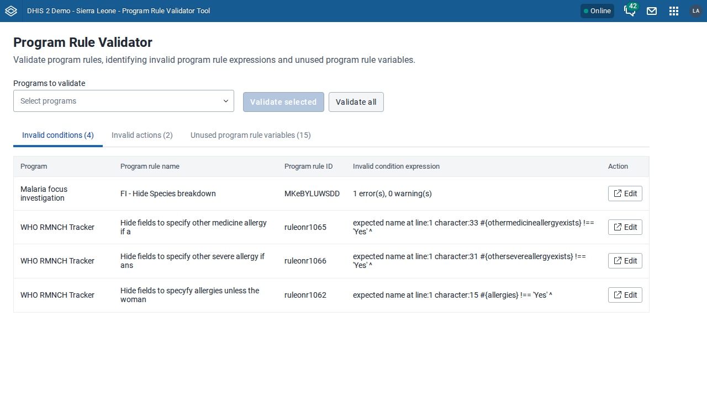
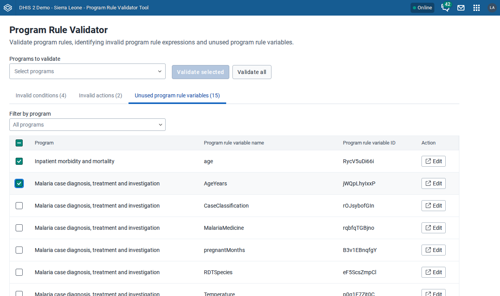
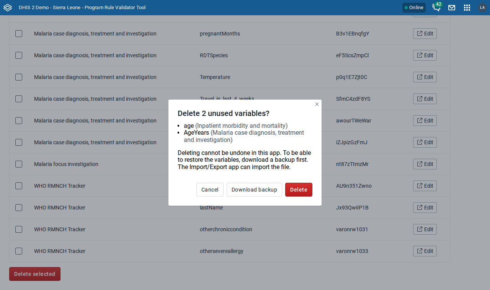

# Program Rule Validator Tool { #tool-program-rule-validator }

## About the tool { #tool-program-rule-validator-about }

The Program Rule Validator Tool checks the program rules in a DHIS2 instance. It finds rule conditions and action expressions that DHIS2 cannot evaluate, and program rule variables that no rule uses. You can then delete unused variables in bulk. The tool is for system administrators who maintain tracker and event programs.

## Before you start { #tool-program-rule-validator-before-you-start }

- The tool works with DHIS2 v40 and later.
- To open the tool, you need a user role that gives access to the **Program Rule Validator Tool** app.
- The tool checks only the programs that you can see.
- To delete program rule variables, you need the **Manage program rule** authority (`F_PROGRAM_RULE_MANAGEMENT`).

> **Warning**
>
> The tool deletes program rule variables, and the tool cannot undo a delete. Try the tool on a copy of your database before you use it on a production server.

## Install the tool { #tool-program-rule-validator-install }

You can install the tool in one of two ways:

- From the **DHIS2 Admin Toolbox** app, if it is installed on your instance.
- From the GitHub release, as described in the following steps.

The tool is not published on the App Hub.

1. Download the `.zip` file of the latest release from the [releases page](https://github.com/dhis2-utils/tool-program-rule-validator/releases).
2. Open the **App Management** app.
3. Click **Manual install**.
4. Click **Upload an app to install**, and choose the `.zip` file.
5. Give the users who need the tool a user role with access to the app.

<!-- VERIFY IN APP: the App Management labels "Manual install" and "Upload an app to install" on v40 to v42 (checked on v43). -->

If you installed version 1.0.0 or earlier, the old app has a different key. Uninstall the old **Program Rule Validator Tool** app in the **App Management** app. Then add the new app to the user roles that gave access to the old one.

## Validate program rules { #tool-program-rule-validator-validate }

1. Open the **Program Rule Validator Tool** app.
2. In **Programs to validate**, choose the programs to check. To check all programs, skip this step.
3. Click **Validate selected**, or click **Validate all** to check all programs.

A progress bar shows while the tool checks the rules. To stop the run, click **Cancel**.

The tool sends each condition and each action expression to DHIS2 to check it. On an instance with thousands of rules, a run sends thousands of requests. Run it at a quiet time on a busy server.

## Review the results { #tool-program-rule-validator-results }

When the run is complete, the results show in three tabs:

- **Invalid conditions** lists the program rules whose condition DHIS2 cannot evaluate. The last column shows the message from DHIS2.
- **Invalid actions** lists the program rules that have an action expression that DHIS2 cannot evaluate.
- **Unused program rule variables** lists the variables that no rule in their program uses.

The message "1 error(s), 0 warning(s)" usually means that the expression refers to a variable that does not exist in the program.

If DHIS2 does not answer for some expressions, the tool tries them again. Expressions that still get no answer are not listed as invalid. A warning above the tabs shows how many there are. Run the validation again to check them.

If your session ends during a run, the tool stops the run and asks you to log in again.

If you cancel a run, or a run fails, the results of the last complete run stay on the screen. A message says that the results are from an earlier run.

## Edit a rule or a variable { #tool-program-rule-validator-edit }

Each row has an **Edit** link. The link opens the rule or the variable in a new tab, in the **Metadata Management** app if you have it, or else in the **Maintenance** app. The tooltip of the link says which app it opens. If you have neither app, the row has no link.

## Delete unused variables { #tool-program-rule-validator-delete }

> **Warning**
>
> The tool cannot undo a delete. Download a backup in step 4 if you might need the variables again.

1. Open the **Unused program rule variables** tab.
2. Optional: in **Filter by program**, choose the programs whose variables you want to see.
3. Choose the checkbox of each variable that you want to delete, and click **Delete selected**. A confirmation opens with the names of the variables.
4. Optional: click **Download backup** to save the variables as a metadata file.
5. Click **Delete**.

Before it deletes, the tool reads the rules of each program again. If a rule uses a variable now, the tool does not delete that variable, and a message tells you so.

To restore variables from a backup file, import the file in the **Import/Export app** as a metadata import.

You can delete variables only from the results of the last run. If the results are from an earlier run, run the validation again.

## Known limitations { #tool-program-rule-validator-limitations }

- A rule can refer to a variable by a name that DHIS2 builds when the rule runs, for example `d2:lastEventDate(d2:concatenate('a', 'b'))`. The tool cannot find such a reference, and lists the variable as unused.
- The tool counts a variable as used if any text in a rule matches its name in quotes, even when the text is not a variable reference. The tool then keeps a variable that might be unused.
- The tool checks variables against the program rules of their own program only. It does not check other places that might refer to a variable by name.
- The results are a snapshot. If someone changes a rule after the run, run the validation again. The tool reads the rules again before it deletes, but not before it shows the results.
- The messages in the results come from DHIS2. Some are short, for example "1 error(s), 0 warning(s)". The text can be different in different DHIS2 versions.
- The tool deletes one variable at a time. If DHIS2 refuses a delete, for example because you do not have the authority, the message shows the reason from DHIS2.
